Mechatronics engineering student in Panama. I make neural networks run on very small chips, measure them on the real
hardware, and say plainly where they lose. **Open to remote contract work** in embedded ML, model quantization and
porting models to microcontrollers.

### Projects

| | |
|---|---|
| **[SYMBEX-1](https://github.com/Eden-sudo/Symbex-1)** · C, C++, Python, PyTorch | Binary (1-bit) neural networks on microcontrollers, checked bit by bit on the chip. ResNet-8 is **5.4× faster than TFLite Micro INT8** on the ESP32-S3 and **14.8×** on the ESP32, in 24-29 KB of flash instead of 96 KB, at a cost in accuracy that the repo measures. [Website](https://symbex-1.pages.dev/) |
| **[VAU-Systems](https://github.com/Eden-sudo/VAU-Systems)** · Python, TensorRT, DeepStream | Edge-AI video security on an NVIDIA Jetson Orin Nano: 4 cameras, YOLOv8-pose, ZeroMQ microservices over shared memory and a vision-language model that describes each incident. Research prototype at CITEP, paused. |
| **[SIG-Lynx](https://github.com/Eden-sudo/SIG-Lynx)** · ROS 2, OpenCV | A robotic arm that turns an object's contour into parametric curves and traces them, tested first in RViz2 and Gazebo. University engineering fair, team of 4. |
| **[UMEBOT](https://github.com/Eden-sudo/UMEBOT-Robotics-Project)** · Python, Kotlin, ROS 2 | Local speech, vision and conversation for a Pepper humanoid robot at UMECIT, still in use at the university. |

### Tools

C · C++ · Python · PyTorch · TFLite Micro · CMSIS-NN · ESP-IDF · PlatformIO · TensorRT · ROS 2 · Gazebo · OpenCV ·
ESP32 / ESP32-S3 / RP2350 / AVR · NVIDIA Jetson · Linux

Spanish (native) · English (technical reading and writing; conversation improving)
